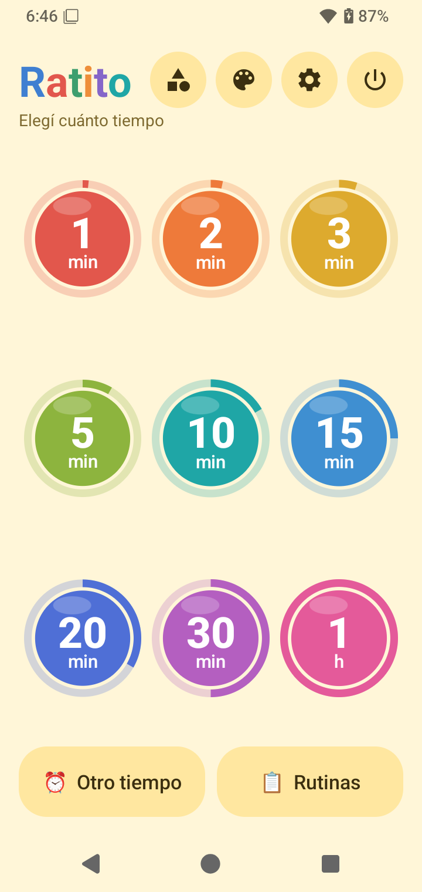
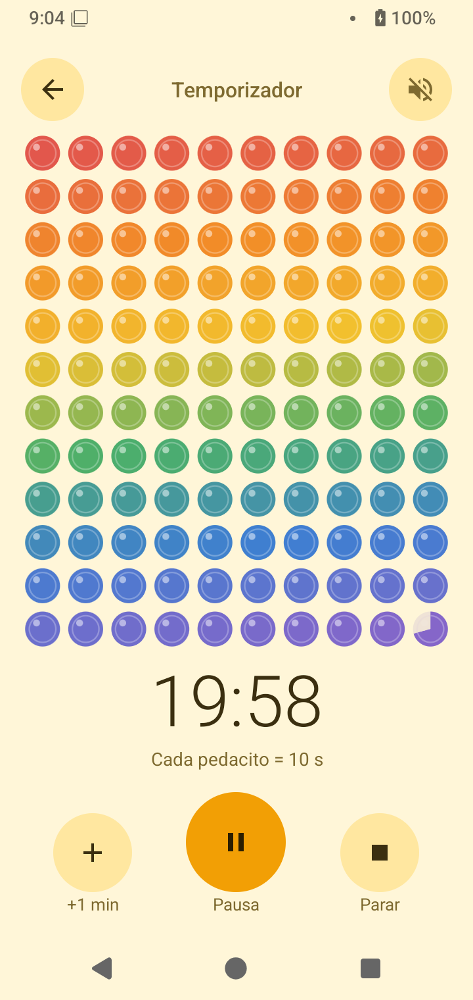
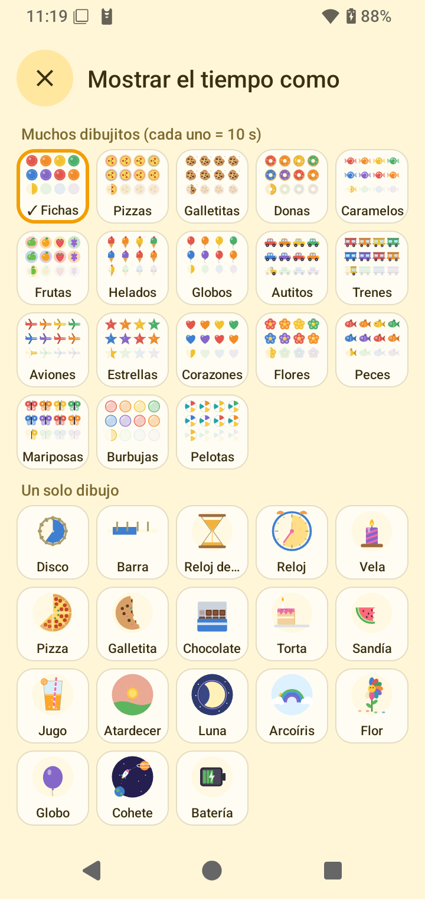

<h1 align="center">Ratito</h1>

<h2 align="center"><a href="https://github.com/matcarfer/Ratito/releases/download/v1.6.0/Ratito-1.6.0.apk">⬇ Download APK</a></h2>

  <a href="README.md">Español</a> · <b>English</b>  
Visual timer and routines for autistic children, children with ADHD and everyone. 
No internet, no ads and no accounts. 
<b>Compatible with Android 7 to 16.</b>

  
  
  

**How to use:** tap a time, or open Routines. You see the time left as drawings, and you can choose shapes, themes and sounds.

  <a href="https://cafecito.app/matcarfer">☕ Cafecito</a> · <a href="https://ko-fi.com/matcarfer">☕ Ko-fi</a> · <a href="https://www.patreon.com/matcarfer">❤ Patreon</a> 
  <a href="https://github.com/matcarfer/biblioteca/blob/main/README.en.md">📚 Software library</a>

---

Free, closed source. Do not redistribute: share this link. No warranty. <a href="LICENSE.en">License</a> · <a href="PRIVACY.md">Privacy</a> · <a href="https://www.virustotal.com/gui/file/1d64dd1ddd050a5a4f8a0f831ccd9e4291d1bc28c514698c4a43830974f5ab49">VirusTotal</a>
