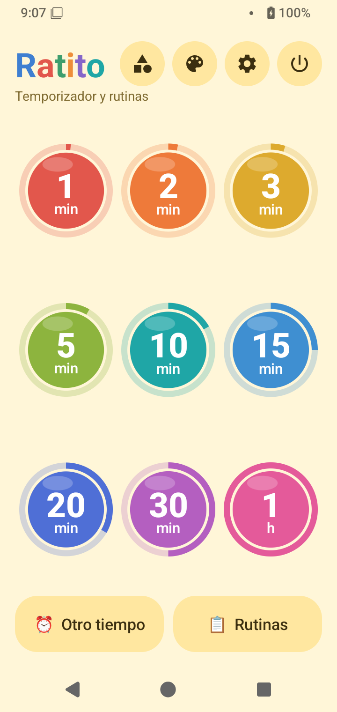
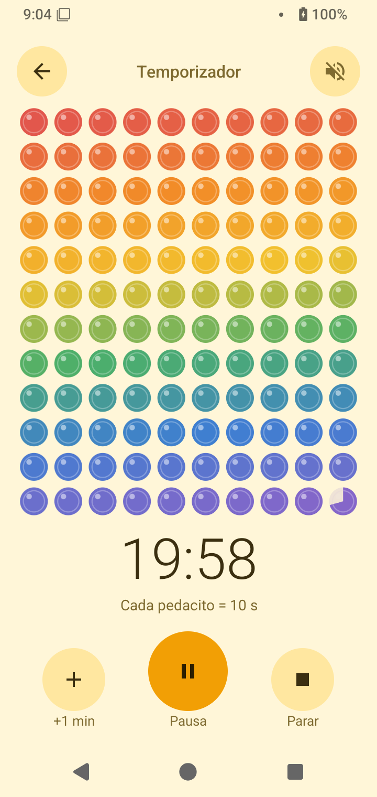
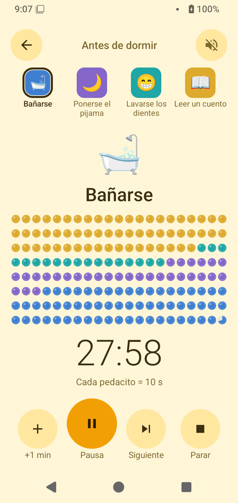
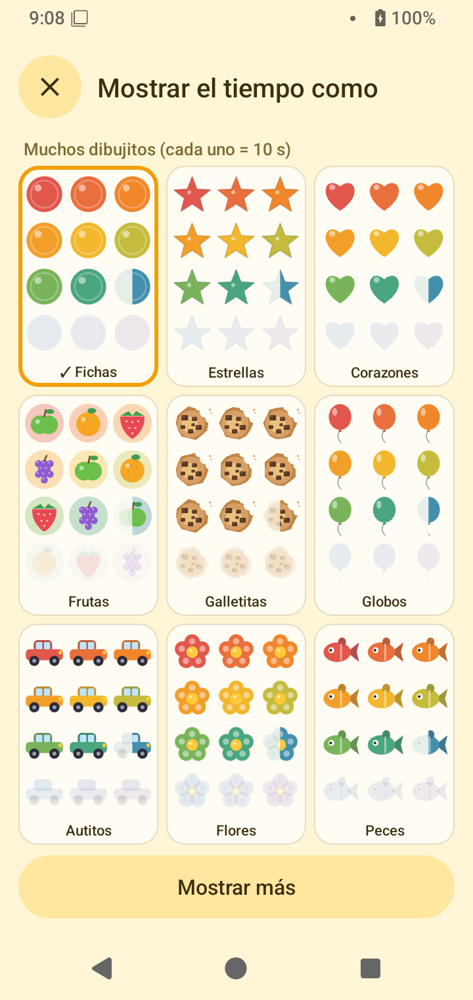

<h1 align="center">Ratito</h1>

<h2 align="center"><a href="https://github.com/matcarfer/Ratito/releases/download/v1.7.0/Ratito-1.7.0.apk">⬇ Descargar APK</a></h2>

  <b>Español</b> · <a href="README.en.md">English</a>  
Temporizador visual y rutinas para chicos con autismo, con TDAH y para todos. 
Sin internet, sin publicidad y sin cuentas. 
<b>Compatible con Android 7 a 16.</b>

  
  
  
  

**Cómo se usa:** tocá un tiempo, o entrá a Rutinas. Ves cuánto falta con dibujos, y podés elegir formas, temas y sonidos.

  <a href="https://cafecito.app/matcarfer">☕ Cafecito</a> · <a href="https://ko-fi.com/matcarfer">☕ Ko-fi</a> · <a href="https://www.patreon.com/matcarfer">❤ Patreon</a> 
  <a href="https://github.com/matcarfer/biblioteca">📚 Biblioteca de software</a>

---

Gratis, de código cerrado. No redistribuir: compartí este link. Sin garantía. <a href="LICENSE">Licencia</a> · <a href="PRIVACY.es.md">Privacidad</a> · <a href="https://www.virustotal.com/gui/file/9c6f66fce892fce6090a643424170853b34f206f6ec43e6807e935df3e0a2fce">VirusTotal</a>
